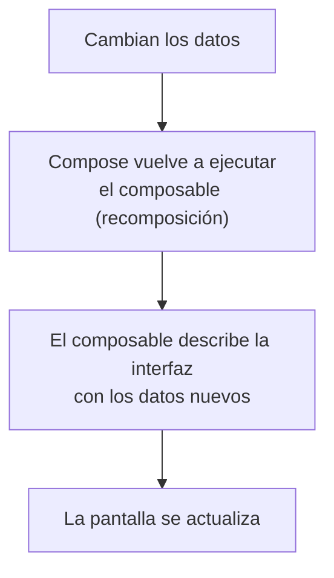
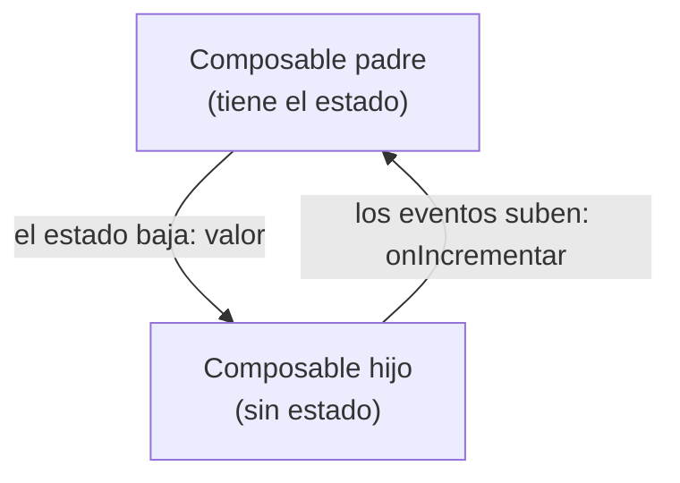

# Capítulo 34: Estado en Compose: recomposición, `remember`, `mutableStateOf` y *state hoisting*

> [!TIP]Antes de empezar, recupera lo que ya sabes
> Responde de memoria; no importa acertar, se trata de activar lo que ya sabes. Vuelve a estas preguntas al terminar el capítulo.
>
> 1. ¿Cuál es la diferencia entre `val` y `var` en Kotlin, y cuándo usarías cada uno?
> 2. ¿Qué es una función lambda y cómo se pasa como argumento (por ejemplo, a `onClick`)?
> 3. ¿Qué componente de Material 3 ejecuta una acción al tocarlo y cómo se llama el parámetro que recibe esa acción? (capítulo 33)

## Introducción

Hasta ahora tus composables muestran siempre lo mismo. Pero una interfaz real **cambia**: un contador que aumenta, un campo de texto que se llena, una casilla que se marca. En este capítulo verás cómo Compose actualiza la pantalla cuando cambian los datos —la **recomposición**— y cómo se declaran esos datos que, al cambiar, la disparan: el **estado** (*state*).

Aprenderás a crear estado con `mutableStateOf`, a conservarlo entre recomposiciones con `remember`, a mantenerlo incluso al girar el dispositivo con `rememberSaveable`, a usarlo con componentes interactivos como `TextField`, `Checkbox` y `Switch`, y una técnica fundamental para organizar bien tu interfaz: el ***state hoisting*** o "elevación del estado".

Para terminar, verás cómo **animar** esos cambios de estado para que la interfaz no salte de un valor a otro de golpe, con las animaciones declarativas de Compose.

## La recomposición

Aquí está la idea central de Compose. En la interfaz tradicional, cuando un dato cambiaba, tenías que buscar el elemento de pantalla y actualizarlo tú a mano. En Compose no: cuando cambian los datos que un composable **lee**, Compose **vuelve a ejecutar** ese composable con los datos nuevos y actualiza lo que se muestra. A ese "volver a ejecutar" se le llama **recomposición**.

Piénsalo así: un composable no es un dibujo fijo, sino una **descripción** de cómo debe verse la interfaz *para unos datos dados*. Si los datos cambian, Compose recalcula la descripción y redibuja solo lo necesario.



Esto es justo lo que anticipamos al hablar de `StateFlow`: la interfaz **observa** los datos y **reacciona** a sus cambios, sin que tengas que actualizarla manualmente. En el resto de este capítulo verás cómo se declaran esos datos que, al cambiar, provocan la recomposición: el **estado**.

> [!IMPORTANT]
> Como un composable puede ejecutarse muchas veces (una por cada recomposición) y en cualquier orden, no debes poner dentro de él acciones con efectos secundarios (como modificar una variable externa o escribir en un archivo). Un composable solo debería **describir** la interfaz a partir de los datos que recibe.

## El problema: una variable normal no basta

Intentemos algo sencillo: un contador que aumenta cada vez que tocas un botón. Con lo que sabes, podrías intentar una variable normal:

```kotlin
@Composable
fun Contador() {
    var contador = 0

    Button(onClick = { contador++ }) {
        Text("Has tocado $contador veces")
    }
}
```

Pero esto **no funciona**: por más que toques el botón, el número no cambia en pantalla. Y hay dos razones:

1. Compose **no sabe** que `contador` cambió, así que no recompone: la interfaz nunca se entera de la actualización.
2. Aunque recompusiera, `contador` es una variable normal que se **reinicia a 0** cada vez que la función se vuelve a ejecutar.

Necesitamos algo que Compose pueda **observar** y que, además, **sobreviva** a las recomposiciones. Esas dos necesidades las resuelven `mutableStateOf` y `remember`.

> [!NOTE]Nota
> `Button` es un componente de Material, que veremos en detalle más adelante. Por ahora basta con saber que su parámetro `onClick` recibe la acción que se ejecuta al tocarlo.

## `mutableStateOf` y `remember`

La solución tiene dos partes que trabajan juntas.

**`mutableStateOf`** crea un valor **observable**: un contenedor de estado que Compose vigila. Cuando su contenido cambia, Compose recompone los composables que lo leen.

**`remember`** le dice a Compose que **recuerde** ese valor entre recomposiciones, en lugar de recrearlo cada vez.

Combinándolos:

```kotlin
@Composable
fun Contador() {
    val contador = remember { mutableStateOf(0) }

    Button(onClick = { contador.value++ }) {
        Text("Has tocado ${contador.value} veces")
    }
}
```

Ahora sí funciona. Al leer `contador.value` dentro del `Text`, Compose registra que ese texto **depende** de ese estado. Cuando tocas el botón y haces `contador.value++`, el estado cambia, Compose recompone y el texto se actualiza con el nuevo número. Y gracias a `remember`, el valor no se pierde entre recomposiciones.

## La sintaxis `by`

Escribir `.value` cada vez es un poco engorroso. Kotlin ofrece una forma más limpia mediante una **propiedad delegada**, con la palabra clave `by`:

```kotlin
@Composable
fun Contador() {
    var contador by remember { mutableStateOf(0) }

    Button(onClick = { contador++ }) {
        Text("Has tocado $contador veces")
    }
}
```

Con `by`, usas `contador` directamente, como si fuera una variable normal: lo lees sin `.value` y lo modificas con `contador++`. Por detrás sigue siendo el mismo estado observable. Fíjate en que ahora se declara con `var`, porque lo vas a modificar. Esta es la forma que verás con más frecuencia.

> [!NOTE]Nota
> Esta sintaxis necesita importar `getValue` y `setValue` de Compose; Android Studio agrega esos imports por ti automáticamente.

## Sobrevivir a la rotación: `rememberSaveable`

¿Recuerdas que, al girar el dispositivo, Android **destruye y recrea** la `Activity`, perdiendo su estado? Ese problema también afecta a `remember`: como la recreación empieza todo de cero, el valor guardado con `remember` se **pierde** al rotar.

Para esos casos existe **`rememberSaveable`**, que funciona igual que `remember`, pero **guarda** el estado y lo **restaura** tras una recreación por cambio de configuración:

```kotlin
var contador by rememberSaveable { mutableStateOf(0) }
```

Con este simple cambio, tu contador conserva su valor aunque gires el teléfono. Úsalo cuando quieras que un estado sobreviva a la rotación (por ejemplo, lo que el usuario escribió en un formulario).

## Componentes con estado: `TextField`, `Checkbox` y `Switch`

Con `remember` y `mutableStateOf` ya puedes usar los componentes de Material 3 que el usuario **modifica**. Todos siguen el mismo patrón.

### `TextField`: la base de los formularios

Un **`TextField`** es un campo de texto editable: el componente con el que construirás prácticamente **todos los formularios** del curso (inicio de sesión, búsqueda, alta de un contacto…).

| Parámetro | Qué hace |
| :--- | :--- |
| `value` | El texto que se muestra **ahora mismo** en el campo. Es obligatorio. |
| `onValueChange` | La función que se ejecuta cada vez que el usuario escribe algo. Es obligatorio. |
| `label` | Una etiqueta que identifica el campo (por ejemplo, "Correo electrónico"). |
| `placeholder` | Un texto de ejemplo que se ve cuando el campo está vacío. |

```kotlin
var nombre by remember { mutableStateOf("") }

TextField(
    value = nombre,
    onValueChange = { nombre = it },
    label = { Text("Nombre") },
    placeholder = { Text("Ingresa tu nombre") }
)
```

Fíjate en el patrón: `value` le dice a `TextField` **qué mostrar**, y `onValueChange` recibe el texto nuevo cada vez que el usuario teclea, para que tú lo guardes (aquí, en `nombre`). Si solo pasaras `value` sin actualizarlo en `onValueChange`, el campo se vería "congelado" y no dejaría escribir, por la misma razón que viste con `Button`: la interfaz no cambia si nadie actualiza el estado que lee. Un formulario real simplemente combina **varios** `TextField` como este, uno por cada dato que pidas.

### `Checkbox` y `Switch`

Un **`Checkbox`** es una casilla de verificación; un **`Switch`** es un interruptor de encendido/apagado. Ambos comparten los mismos parámetros:

| Parámetro | Qué hace |
| :--- | :--- |
| `checked` | Si está marcado o activado. Es obligatorio. |
| `onCheckedChange` | La función que se ejecuta cuando el usuario lo toca, con el nuevo valor. Es obligatorio. |

```kotlin
var aceptaTerminos by remember { mutableStateOf(false) }

Row(verticalAlignment = Alignment.CenterVertically) {
    Checkbox(
        checked = aceptaTerminos,
        onCheckedChange = { aceptaTerminos = it }
    )
    Text("Acepto los términos y condiciones")
}
```

Para un `Switch`, el uso es idéntico: solo cambia el componente.

```kotlin
var notificacionesActivas by remember { mutableStateOf(true) }

Switch(
    checked = notificacionesActivas,
    onCheckedChange = { notificacionesActivas = it }
)
```

Fíjate en el patrón que se repite en los tres: cada componente interactivo recibe los **datos a mostrar** (`value`, `checked`) y una **función de devolución de llamada** (`onValueChange`, `onCheckedChange`) para reaccionar a la interacción del usuario, igual que viste con `Button` y su `onClick`. Es el mismo patrón que acabas de ver con `remember` y `mutableStateOf`: el componente no guarda nada por sí mismo; muestra el estado que recibe y avisa cuando el usuario quiere cambiarlo.

## State hoisting: elevar el estado

Hasta ahora, nuestro `Contador` guarda su propio estado dentro de sí mismo. Funciona, pero tiene inconvenientes: nadie desde fuera puede conocer el valor actual ni controlarlo, y el composable es difícil de reutilizar y de previsualizar con distintos valores.

La solución es el ***state hoisting*** ("elevación del estado"): **sacar el estado del composable y moverlo hacia quien lo llama**. El composable queda **sin estado** (*stateless*): recibe el valor a mostrar y una **función** para avisar de los cambios.

```kotlin
@Composable
fun Contador(valor: Int, onIncrementar: () -> Unit) {
    Button(onClick = onIncrementar) {
        Text("Has tocado $valor veces")
    }
}
```

Ahora `Contador` no guarda nada: solo muestra el `valor` que recibe y, al tocarlo, invoca `onIncrementar`. El estado vive en el composable **padre**:

```kotlin
@Composable
fun Pantalla() {
    var contador by remember { mutableStateOf(0) }

    Contador(
        valor = contador,
        onIncrementar = { contador++ }
    )
}
```

Fíjate en el patrón: el **estado baja** (el padre le pasa `valor` al hijo) y los **eventos suben** (el hijo avisa al padre con `onIncrementar`). A este flujo en una sola dirección se le llama **flujo de datos unidireccional**:



Este patrón trae grandes ventajas: el composable `Contador` es **reutilizable** (sirve con cualquier valor y cualquier acción), fácil de **previsualizar** (le pasas un valor fijo) y hay una **única fuente de verdad** para el estado. Es, además, la misma idea que viste en el capítulo 29 sobre la arquitectura MVVM, aplicada ahora a un solo composable en vez de a toda la pantalla: el estado vive en un solo lugar, la interfaz lo observa y le comunica los eventos.

## Animar cambios de estado

Cada vez que cambia el estado, la interfaz **salta** de golpe al nuevo valor. Para muchas cosas está bien: un contador debe mostrar el número nuevo al instante. Pero otros cambios se sienten bruscos o desconcertantes: un color que aparece, un elemento que se muestra de repente, un tamaño que da un salto. Compose puede **interpolar** esos cambios, es decir, recorrer los valores intermedios para que el cambio se vea como una transición suave.

La clave es que, igual que con el estado, **no describes la animación fotograma a fotograma**. Tú solo cambias el valor objetivo (el estado) y Compose calcula el camino. A esto se le llama **animación declarativa**: describes *a dónde* quieres llegar, no *cómo* llegar.

### Animar un valor: `animate*AsState`

Las funciones `animate*AsState` envuelven un valor y lo animan cuando su valor objetivo cambia. Hay una por cada tipo; las dos más útiles al principio son:

- **`animateColorAsState`**: para colores.
- **`animateDpAsState`**: para tamaños, rellenos y desplazamientos (`Dp`).

Igual que `mutableStateOf`, devuelven un `State<T>`, así que se leen con `by`:

```kotlin
@Composable
fun TarjetaSeleccionable(seleccionada: Boolean) {
    val colorFondo by animateColorAsState(
        targetValue = if (seleccionada) MaterialTheme.colorScheme.primaryContainer
                      else MaterialTheme.colorScheme.surfaceVariant,
        label = "colorFondo"
    )

    Surface(color = colorFondo, shape = MaterialTheme.shapes.medium) {
        Text("Tócame", modifier = Modifier.padding(16.dp))
    }
}
```

Aquí `colorFondo` no salta de un color a otro: **recorre** los colores intermedios. Cuando `seleccionada` cambia, la animación se dispara sola; no hay que arrancarla ni detenerla a mano. El mismo patrón sirve para un tamaño:

```kotlin
val relleno by animateDpAsState(
    targetValue = if (expandida) 24.dp else 8.dp,
    label = "relleno"
)

Box(modifier = Modifier.padding(relleno)) { /* ... */ }
```

Por eso a estas funciones se las llama animaciones **de disparar y olvidar** (*fire-and-forget*): cambias el objetivo y ya está. El parámetro `animationSpec` permite ajustar el ritmo (por ejemplo, `tween(durationMillis = 300)` para una duración fija); si lo omites, Compose usa un `spring` (un muelle con física propia) que suele verse natural.

> [!NOTE]Nota
> El parámetro `label` es solo un nombre para distinguir esta animación de otras en las herramientas de Android Studio; no afecta al resultado. Para leer el `State<T>` con `by` necesitarás `import androidx.compose.runtime.getValue`, que Android Studio agrega por ti. `animateColorAsState` viene de `androidx.compose.animation` y `animateDpAsState` de `androidx.compose.animation.core`.

### Mostrar y ocultar contenido: `AnimatedVisibility`

Para animar la **aparición y desaparición** de una parte de la interfaz, en lugar de un `if`, usa `AnimatedVisibility`. Recibe un booleano `visible` y el contenido que se muestra u oculta:

```kotlin
AnimatedVisibility(visible = mostrarDetalle) {
    Text("Detalle que aparece con una transición suave")
}
```

Por defecto, el contenido hace un *fade* (aparece y desaparece con opacidad) y se expande o se contrae al mismo tiempo. Puedes afinar el efecto con los parámetros `enter` y `exit`, combinando transiciones con el operador `+`:

```kotlin
AnimatedVisibility(
    visible = mostrarDetalle,
    enter = slideInVertically() + fadeIn(),
    exit = slideOutVertically() + fadeOut()
) {
    Text("Detalle que se desliza desde arriba")
}
```

A diferencia de cambiar solo la opacidad (`Modifier.alpha`), `AnimatedVisibility` **quita el contenido de la composición** cuando termina de ocultarse, así que deja de ocupar espacio y los lectores de pantalla dejan de verlo. Por eso es la opción recomendada cuando algo debe *desaparecer* de verdad, y no solo volverse transparente.

> [!TIP]Sugerencia
> Para animar un cambio de **tamaño** sin más ceremonia, añade `Modifier.animateContentSize()` al contenedor (`androidx.compose.animation`): cuando su contenido cambia de tamaño, el contenedor crece o decrece con una animación. Es un buen primer paso antes de meterse con transiciones más elaboradas.

### Un ejemplo completo

Combinemos las piezas en un aviso que se despliega al tocarlo. El color y la elevación se animan con `animate*AsState`, y el contenido oculto aparece con `AnimatedVisibility`:

```kotlin
@Composable
fun AvisoDesplegable() {
    var expandido by remember { mutableStateOf(false) }
    val elevacion by animateDpAsState(if (expandido) 8.dp else 0.dp, label = "elevacion")

    Column {
        Surface(
            onClick = { expandido = !expandido },
            shadowElevation = elevacion,
            shape = MaterialTheme.shapes.medium
        ) {
            Text("Ver más", modifier = Modifier.padding(16.dp))
        }
        AnimatedVisibility(visible = expandido) {
            Text(
                "Contenido adicional que se despliega con una transición suave.",
                modifier = Modifier.padding(16.dp)
            )
        }
    }
}
```

Fíjate en que el estado (`expandido`) sigue siendo una variable normal con `remember { mutableStateOf(...) }`, gobernada por el patrón que ya conoces. Las animaciones **no** gestionan el estado: solo lo *presentan* de forma gradual. Si mañana mueves `expandido` a un `ViewModel`, las animaciones siguen funcionando sin cambios.

> [!WARNING]Advertencia
> La animación es un **detalle de presentación**, no un sustituto de un buen estado. Si el estado está mal organizado, una animación solo esconde el problema. Úsala para **reforzar** un cambio que el usuario ya entiende —un color que confirma una selección, un contenido que se despliega—, no para disimular que la interfaz no reacciona.

> [!NOTE]Nota
> **Accesibilidad y movimiento.** Compose respeta la escala de duración de animaciones del sistema: si el usuario reduce o desactiva las animaciones (por ejemplo, con «Eliminar animaciones» en Accesibilidad), las transiciones se acortan o desaparecen sin que tengas que hacer nada. Aun así, no dependas de una animación para comunicar información esencial: si algo importa, debe entenderse también sin movimiento.

## Resumen

En este capítulo aprendiste a manejar el estado en Compose:

- La **recomposición** es el mecanismo por el que Compose **vuelve a ejecutar** un composable cuando cambian los datos que lee. Un composable describe la UI para unos datos dados y no debe tener efectos secundarios.
- El **estado** son los datos que, al cambiar, provocan la recomposición.
- **`mutableStateOf`** crea un valor **observable** por Compose; **`remember`** lo **conserva** entre recomposiciones. Juntos: `remember { mutableStateOf(...) }`.
- La sintaxis **`by`** te deja usar el estado como una variable normal, sin `.value`.
- **`rememberSaveable`** conserva el estado también tras una recreación por cambio de configuración (como girar el dispositivo).
- Los componentes interactivos (`TextField`, `Checkbox`, `Switch`) reciben el **valor a mostrar** y una **función** que se ejecuta cuando el usuario lo cambia.
- El ***state hoisting*** consiste en **elevar el estado** al composable padre, dejando al hijo **sin estado**: recibe el valor y una función para los eventos. Esto sigue el **flujo de datos unidireccional** (el estado baja, los eventos suben) y hace tus composables reutilizables.
- Las **animaciones declarativas** suavizan un cambio de estado sin describir fotogramas: cambias el valor objetivo y Compose interpola. `animateColorAsState`/`animateDpAsState` devuelven un `State<T>` y se leen con `by`; `AnimatedVisibility` muestra u oculta contenido quitándolo de la composición; `Modifier.animateContentSize()` anima cambios de tamaño. La animación refuerza el cambio, nunca lo sustituye.

## Para cerrar

¿Qué se ve en el campo cuando el usuario escribe en él? ¿Qué pasaría si borraras la línea que actualiza el estado?

```kotlin
@Composable
fun Campo() {
    val texto = remember { mutableStateOf("") }
    TextField(
        value = texto.value,
        onValueChange = { texto.value = it }
    )
}
```

Responde antes de desplegar la respuesta.

??? success "Ver respuesta y razonamiento"
    El campo se actualiza con cada tecla: `onValueChange` guarda el texto nuevo en el estado y Compose **recompone** con ese valor. Si quitaras la línea `texto.value = it`, el campo quedaría "congelado": recibiría siempre `""` como `value` y no dejaría escribir. Error común: pensar que `TextField` guarda el texto por sí solo; en Compose el estado vive fuera y el componente solo lo muestra.

En el próximo capítulo montarás el esqueleto de una pantalla completa con `Scaffold` y mostrarás listas largas con `LazyColumn`.
