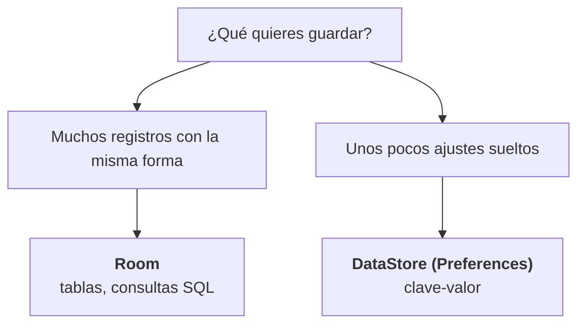
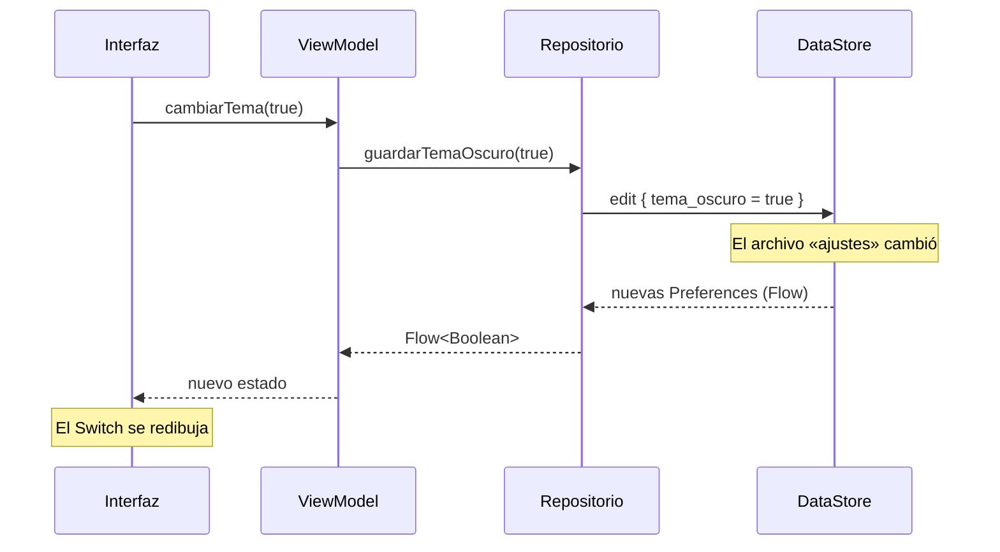

# Capítulo 51: Preferencias con DataStore

> [!TIP]Antes de empezar, recupera lo que ya sabes
> Responde de memoria; no importa acertar, se trata de activar lo que ya sabes. Vuelve a estas preguntas al terminar el capítulo.
>
> 1. ¿Qué devuelve un `Flow` y cómo lo conviertes en el estado de una pantalla? (capítulos 25 y 50)
> 2. ¿Por qué conviene que el `ViewModel` dependa de una **interfaz** de repositorio y no de una implementación concreta? (capítulo 44)
> 3. ¿Qué tienen en común `mutableStateOf` y las funciones `animate*AsState` del capítulo 34? Pista: ambas devuelven un `State<T>`.

## Introducción

En el capítulo anterior guardaste **muchos datos con la misma forma** —notas, tareas, contactos— en una base de datos con tablas, filas y consultas. Room es la herramienta ideal para eso.

Pero no todo lo que una app recuerda es una colección de registros. Piensa en estos datos:

- Si el usuario prefiere el **tema oscuro**.
- En qué **orden** quiere ver sus tareas.
- Si ya **vio** la pantalla de bienvenida.
- La **última ciudad** que consultó en una app del clima.

Son unos pocos valores **sueltos**, cada uno con su propia clave, y no forman una tabla: guardar cada uno como una fila sería complicado y desproporcionado. Para esto existe **DataStore**, la biblioteca moderna de Android para guardar datos pequeños de tipo **clave-valor**.

En este capítulo verás por qué DataStore sustituye a las antiguas `SharedPreferences`, cómo crear un **Preferences DataStore**, cómo **leer** y **escribir** valores con `Flow` y funciones `suspend`, y cómo integrarlo **detrás de un repositorio**, igual que hiciste con Room.

## ¿Room o DataStore? Dos formas de recordar

Antes de escribir código, conviene tener clara la decisión. Ambas bibliotecas guardan datos en el teléfono, pero resuelven problemas distintos:

| | **Room** | **DataStore (Preferences)** |
| :--- | :--- | :--- |
| Qué guarda | Colecciones de datos con la misma forma | Unos pocos valores sueltos clave-valor |
| Cómo se consulta | SQL: filtros, ordenaciones, relaciones | Leer una clave concreta |
| Encaja bien con | Listas, relaciones, caché de un servidor | Ajustes del usuario, opciones, banderas |
| Ejemplo | Tareas, contactos, notas | Tema oscuro, orden de la lista, la última ciudad |

La regla práctica:



Si lo que guardas **se parece a una lista de cosas**, usa Room. Si son **un puñado de ajustes**, usa DataStore. (Si dudas, pregúntate cuántos valores habrá: tres o cuatro ajustes no justifican una base de datos completa.)

En la app «Mis Contactos» de la Parte X verás las dos ideas conviviendo: las listas de contactos y favoritos van a Room, mientras que un ajuste como «mostrar solo favoritos» encajaría de forma natural en DataStore.

## ¿Y las `SharedPreferences`?

Quizá hayas oído hablar de **`SharedPreferences`**, la forma clásica de guardar ajustes en Android. Todavía existe, pero tiene problemas:

- Sus lecturas y escrituras pueden **bloquear el hilo principal**, justo lo que llevas todo el curso evitando con las corrutinas.
- No expone los cambios como un `Flow`, así que no encaja con la interfaz reactiva de Compose.
- No es transaccional: leer, modificar y escribir no es una sola operación segura.

**DataStore** es su sustituto moderno y resuelve las tres cosas: trabaja con corrutinas y `Flow`, no bloquea la interfaz y agrupa cada cambio en una operación atómica. Para código nuevo, usa DataStore.

> [!NOTE]Nota
> DataStore tiene dos variantes: **Preferences**, para valores sueltos clave-valor (la de este capítulo), y **Proto**, para guardar mensajes tipados definidos con *Protocol Buffers*. Para ajustes sencillos, Preferences es la adecuada; Proto se reserva para estructuras más complejas.

## Configurar el proyecto

DataStore se agrega como cualquier otra dependencia. Primero, el catálogo de versiones `gradle/libs.versions.toml`:

```toml
[versions]
datastore = "1.2.1"

[libraries]
androidx-datastore-preferences = { group = "androidx.datastore", name = "datastore-preferences", version.ref = "datastore" }
```

Y en el `build.gradle.kts` del módulo **`app`**:

```kotlin
dependencies {
    // ...
    implementation(libs.androidx.datastore.preferences)
}
```

No necesita plugins ni procesadores de anotaciones: es una biblioteca normal que se agrega con `implementation(...)`.

> [!WARNING]Advertencia
> Las versiones de las bibliotecas de Android cambian con el tiempo y deben ser compatibles con tu proyecto. Las de este capítulo son las que se usaron para probar los ejemplos del curso; si al sincronizar Gradle aparece un error, consulta la página de versiones de DataStore y ajusta el número.

## Crear el DataStore

Un DataStore se declara **una sola vez** en toda la app, con un *delegado de propiedad* sobre un `Context`:

```kotlin
val Context.dataStore: DataStore<Preferences> by preferencesDataStore(name = "ajustes")
```

Tres cosas importantes de esta línea:

- Va en el **nivel superior** del archivo (fuera de cualquier clase), porque debe existir una **única instancia** por nombre y proceso. Si crearas dos DataStore con el mismo archivo, sus escrituras competirían entre sí.
- `name = "ajustes"` es el **nombre del archivo** donde se guardan los datos. DataStore lo crea solo, dentro de la carpeta interna de la app.
- El tipo es `DataStore<Preferences>`: un almacén de pares clave-valor.

Después, declara las **claves**, también en el nivel superior, con el tipo de cada valor:

```kotlin
private val CLAVE_TEMA_OSCURO = booleanPreferencesKey("tema_oscuro")
private val CLAVE_CIUDAD = stringPreferencesKey("ciudad")
```

Cada `*PreferencesKey` corresponde a un tipo: `booleanPreferencesKey`, `intPreferencesKey`, `longPreferencesKey`, `floatPreferencesKey`, `stringPreferencesKey`, `doublePreferencesKey` y `stringSetPreferencesKey`. La clave es un **nombre** (`"tema_oscuro"`); el nombre de la constante de Kotlin (`CLAVE_TEMA_OSCURO`) es solo para el programador. Declararla una vez evita escribir el texto a mano en varios sitios y equivocarse.

## Leer valores

El DataStore expone sus datos como un **`Flow`**:

```kotlin
val temaOscuro: Flow<Boolean> = context.dataStore.data
    .catch { e ->
        if (e is IOException) emit(emptyPreferences()) else throw e
    }
    .map { prefs -> prefs[CLAVE_TEMA_OSCURO] ?: false }
```

Vamos por partes:

- **`dataStore.data`** es un `Flow<Preferences>` que emite los valores actuales **y vuelve a emitir cada vez que algo cambia**. Igual que el `Flow` de Room, la interfaz se actualizará sola.
- **`.catch { ... }`** atrapa errores de lectura. Si el archivo está corrupto o no se puede leer, DataStore lanza una `IOException`; en ese caso emitimos preferencias **vacías** para recuperar un estado conocido, en vez de que el `Flow` muera. **Cualquier otro error se vuelve a lanzar** (con `throw e`), porque no es un problema de lectura que debamos silenciar.
- **`.map { prefs -> prefs[CLAVE_TEMA_OSCURO] ?: false }`** lee una clave concreta. Fíjate en el `?: false`: una clave que **nunca se ha escrito** no está en `prefs`, y `prefs[clave]` devuelve `null`. El valor por defecto es **decisión tuya**, así que se pone aquí, explícitamente.

> [!TIP]Sugerencia
> Guarda el `Flow` ya mapeado (con su valor por defecto) en tu repositorio, para que el resto de la app reciba `Flow<Boolean>` y no tenga que saber nada de claves ni de `Preferences`.

## Escribir valores

Para escribir se usa `edit`, una función `suspend` que recibe un bloque donde modificas las claves:

```kotlin
suspend fun guardarTemaOscuro(context: Context, activo: Boolean) {
    context.dataStore.edit { prefs ->
        prefs[CLAVE_TEMA_OSCURO] = activo
    }
}
```

`edit` es **atómico**: lee los valores, aplica tus cambios y los escribe como **una sola operación**. Si dos partes de la app escriben a la vez, no se pisan. Es una función `suspend`, así que debes llamarla desde una **corrutina** (por ejemplo, `viewModelScope.launch { ... }`), nunca desde el cuerpo de un composable.

> [!WARNING]Advertencia
> No guardes una referencia al objeto `prefs` del bloque `edit` para usarlo después: solo es válido **dentro** del bloque. Y no asumas que el dato quedó guardado hasta que `edit` termina correctamente.

## Detrás de un repositorio

Igual que Room en el capítulo anterior, DataStore conviene **escondido detrás de un repositorio**. Así el `ViewModel` y la interfaz trabajan con tipos de tu dominio (`Flow<Boolean>`, funciones `suspend`) y no conocen ni las claves ni los detalles de la biblioteca. Y, como siempre, eso permite sustituir o simular la implementación en las pruebas.

```kotlin
interface PreferenciasRepository {
    val temaOscuro: Flow<Boolean>
    suspend fun guardarTemaOscuro(activo: Boolean)
}

@Singleton
class PreferenciasRepositoryDataStore @Inject constructor(
    @ApplicationContext private val context: Context
) : PreferenciasRepository {

    override val temaOscuro: Flow<Boolean> = context.dataStore.data
        .catch { e -> if (e is IOException) emit(emptyPreferences()) else throw e }
        .map { prefs -> prefs[CLAVE_TEMA_OSCURO] ?: false }

    override suspend fun guardarTemaOscuro(activo: Boolean) {
        context.dataStore.edit { prefs -> prefs[CLAVE_TEMA_OSCURO] = activo }
    }
}
```

- El repositorio recibe el `Context` con **`@ApplicationContext`**, como el `DatabaseModule` del capítulo 50: DataStore necesita un `Context` para ubicar su archivo, y debe ser el de la **aplicación** (no el de una pantalla), porque el DataStore vive tanto como la app.
- Cada método del repositorio es una traducción directa: leer una clave, escribir una clave.

Y se enlaza con Hilt como cualquier otra implementación:

```kotlin
@Binds
@Singleton
abstract fun bindPreferenciasRepository(impl: PreferenciasRepositoryDataStore): PreferenciasRepository
```

## Del ajuste a la pantalla

El `ViewModel` consume el repositorio como cualquier otro. Como el valor es un `Flow`, se convierte en estado de pantalla con `stateIn`, exactamente igual que el `Flow` de Room:

```kotlin
@HiltViewModel
class AjustesViewModel @Inject constructor(
    private val preferencias: PreferenciasRepository
) : ViewModel() {

    val temaOscuro: StateFlow<Boolean> = preferencias.temaOscuro
        .stateIn(
            scope = viewModelScope,
            started = SharingStarted.WhileSubscribed(5_000),
            initialValue = false
        )

    fun cambiarTema(activo: Boolean) {
        viewModelScope.launch {
            preferencias.guardarTemaOscuro(activo)
        }
    }
}
```

Y la pantalla observa ese estado y reacciona con un `Switch`, el componente que ya conoces del capítulo 34:

```kotlin
@Composable
fun AjustesScreen(viewModel: AjustesViewModel = hiltViewModel()) {
    val temaOscuro by viewModel.temaOscuro.collectAsStateWithLifecycle()

    Row(verticalAlignment = Alignment.CenterVertically) {
        Text("Tema oscuro", modifier = Modifier.weight(1f))
        Switch(
            checked = temaOscuro,
            onCheckedChange = viewModel::cambiarTema
        )
    }
}
```

Fíjate en el flujo completo, idéntico al de Room: la interfaz **lee** un `StateFlow`, el usuario **emite un evento** (`onCheckedChange`), el `ViewModel` **escribe** en el repositorio, DataStore **notifica** el cambio por su `Flow` y la pantalla se **recompone** con el valor nuevo. La interfaz nunca toca DataStore directamente.



## Resumen

- **DataStore** es la biblioteca moderna de Android para guardar datos pequeños de tipo **clave-valor** (ajustes, opciones, banderas); sustituye a las `SharedPreferences`.
- Elige **Room** para colecciones de datos con la misma forma (listas, relaciones) y **DataStore** para unos pocos ajustes sueltos.
- Se crea una sola vez con el delegado `val Context.dataStore by preferencesDataStore(name = "...")`, y las claves con `booleanPreferencesKey`, `stringPreferencesKey`, etc.
- Se **lee** con `dataStore.data`, un `Flow<Preferences>` que vuelve a emitir cuando algo cambia; se lee cada clave con `prefs[CLAVE] ?: valorPorDefecto`.
- Se **escribe** con `dataStore.edit { ... }`, una función `suspend` y **atómica**, llamada desde una corrutina.
- Como con Room, conviene **esconderlo detrás de un repositorio** y exponer su `Flow` con `stateIn` en el `ViewModel`. La interfaz solo observa estado y emite eventos.

## Para cerrar

Quieres exponer si las notificaciones están activas como `Flow<Boolean>`. Este código **no compila**. ¿Por qué, y cómo lo arreglas?

```kotlin
private val CLAVE_NOTIFICACIONES = booleanPreferencesKey("notificaciones")

val notificaciones: Flow<Boolean> = context.dataStore.data
    .map { prefs -> prefs[CLAVE_NOTIFICACIONES] }
```

Responde antes de desplegar la respuesta.

??? success "Ver respuesta y razonamiento"
    El error es el **tipo**. `prefs[CLAVE_NOTIFICACIONES]` devuelve `Boolean?` (con signo de interrogación), porque la clave podría **no existir todavía**: si el usuario nunca ha tocado ese ajuste, no hay valor guardado. Por eso el `Flow` que produce el `map` es `Flow<Boolean?>`, que **no coincide** con el `Flow<Boolean>` declarado.

    La solución es dar un valor por defecto explícito:

    ```kotlin
    val notificaciones: Flow<Boolean> = context.dataStore.data
        .catch { e -> if (e is IOException) emit(emptyPreferences()) else throw e }
        .map { prefs -> prefs[CLAVE_NOTIFICACIONES] ?: true }
    ```

    Cada ajuste decide su propio valor de partida (`?: true` si quieres notificaciones activadas por defecto, `?: false` si no). Error común: pensar que una preferencia no escrita vale `false` o `0` «por sí sola»; no vale nada hasta que **tú** definas el valor por defecto. Y no olvides el `.catch { ... }` para que un archivo ilegible no tumbe el `Flow`.

Con esto cierras la Parte IX: ya sabes comunicarte con un servidor, modelar los datos, guardar colecciones con Room y recordar ajustes sueltos con DataStore. En la Parte X reunirás todo esto para construir **«Mis Contactos»** de principio a fin.
